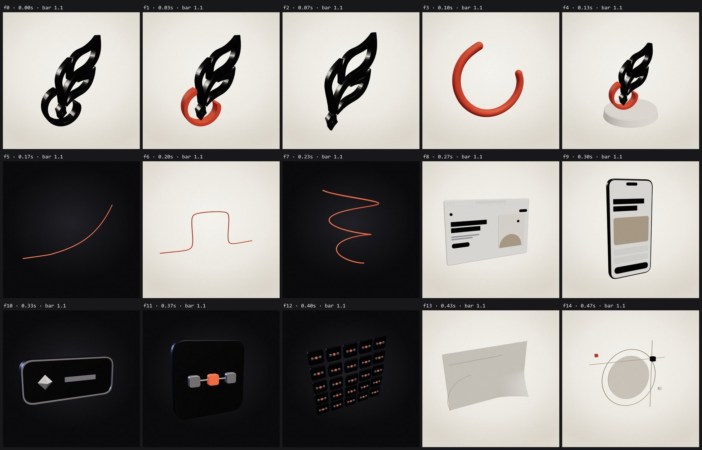

# ProtoVinci 3D models — built from code

Fifteen 3D assets generated entirely in code with three.js geometry: no modelling software, no scans, no AI. Every curve of the logo comes from the traced official mark.



## Use them anywhere

| Where | How |
| --- | --- |
| Blender, Cinema 4D, Spline, Unity, Unreal, Figma plugins | Import `glb/<id>.glb` (glTF 2.0 binary, PBR materials, real-world-agnostic units: 1 = logo height) |
| A website | `<model-viewer src="glb/logo-mark-two-tone.glb" camera-controls auto-rotate>` or three.js `GLTFLoader` |
| React / Next.js / Remotion | `code/Model.tsx` (React Three Fiber): `<Model id="logo-plinth" />` builds the geometry live, no files needed |
| Remotion video | `Turntable` and `Turntable-Wide` compositions in this project: `npx remotion render Turntable out.mp4 --props=props.json --gl=angle` |
| Browse them | `npx serve asset-library/3d` then open `/viewer.html` |

## Catalogue

| id | What | Use it for |
| --- | --- | --- |
| `logo-mark` | Full mark, extruded, ink | 3D logo, app splash, hero shots |
| `logo-mark-two-tone` | Quill in ink, cradle in sanguine | The film's idea in one object |
| `quill` | The quill alone | A pen that draws in 3D scenes |
| `cradle-tube` | The cradle as a round red tube | The line, shaped as the logo |
| `logo-plinth` | Two-tone mark on a paper plinth | Product-style brand shots |
| `line-climb` | Red line, flat then exponential (glowing) | Growth, "Scale" |
| `line-step` | Red line stepping over a window outline | "Build", transitions |
| `line-helix` | Red line rising in a spiral (glowing) | Abstract hero loops |
| `browser-window` | Browser with the landing page in relief | Web projects |
| `phone` | Phone with the mobile layout | Mobile projects |
| `workflow-node` | Dark tile with metal edge | Automation diagrams in 3D |
| `scale-unit` | The three-node tile from the Scale scene | Systems, infrastructure |
| `scale-field` | 5×5 field of units, centre raised | "Systems that grow" |
| `paper-sheet` | Notebook sheet with a curled corner and construction marks | "On paper", idea stage |
| `construction-set` | Ring, disc, rules and blocks from the LinkedIn cover | Backgrounds, compositions |

## Materials

Named PBR materials in `code/models.ts` (`MATERIALS`): `ink`, `paper`, `paperBright`, `white`, `rule`, `zinc`, `taupe`, `taupeLight`, `sanguine`, `sanguineGlow` (emissive), `nightCard`, `nightEdge`, `glass`. GLB files carry them by name, so they can be restyled in any tool. In React, swap any part's material: `<Model id="logo-mark" override={{ cradle: "sanguine" }} />`.

## Regenerate or add models

```bash
node --no-warnings scripts/three/export-glb.mjs        # writes glb/
node --no-warnings scripts/three/render-previews.mjs   # writes previews/ (needs Remotion)
```

To add a model: write a builder in `src/three/models.ts` that returns `{ id, title, parts }`, add it to `buildAll` and `MODEL_IDS`, then run both commands. Keep that file free of project imports, so Node can run it directly.

## Notes

- The logo is extruded from a trace of the 400 px official avatar. Edges are smooth at normal viewing sizes; an official vector logo would allow sharper extreme close-ups.
- The GLB writer (`code/export-glb.mjs`) is self-contained, so it needs no browser APIs. It writes positions, normals, indices and PBR material factors; there are no textures or UVs.
- `viewer.html` loads `<model-viewer>` from a CDN and needs a local server for the .glb files.
