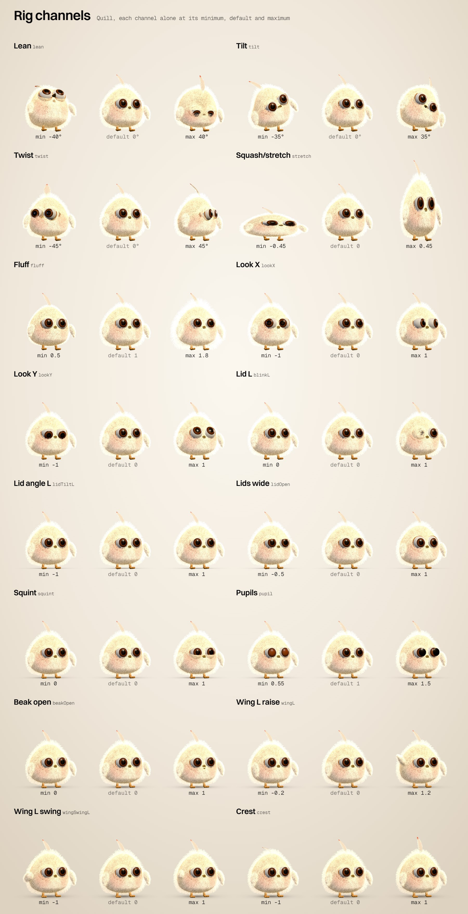

# Rig reference

> Generated from `src/world3d/rig/schema.ts` by `scripts/docs/make-rig-reference.mjs`. Do not edit by hand: change the schema and regenerate.

Every control of the three birds (Quill, Ink and Chalk) is one number, a **channel**. They all share the same channels, so a pose or a move made for one bird works on the others. A clip stores keys per channel (see [ANIMATOR-GUIDE.md](ANIMATOR-GUIDE.md)); Puppet Studio builds its sliders and timeline rows from this list.

Units: positions are in set units, where **1 u is Quill's body height** (about 10 cm in the Desk's miniature world). Angles are in degrees. Left and right (`L`, `R`) are screen-left (−x) and screen-right (+x) when the bird faces the camera.

## Body

Where the bird stands and how its whole body bends. `x`, `y`, `z` and `yaw` place it in the world; the rest shape it.

| Channel | Name in the editor | Range | Default | What it does |
| --- | --- | --- | --- | --- |
| `x` | Move X | -6 u … 6 u | 0 u | Position left/right on the ground (1 u = Quill's height). |
| `z` | Move Z | -6 u … 6 u | 0 u | Position toward (+) or away from (-) the camera. |
| `y` | Lift | 0 u … 3 u | 0 u | Height off the ground: hops, jumps, being picked up. Feet leave the ground. |
| `yaw` | Turn | -180° … 180° | 0° | Facing. 0 looks at the camera. |
| `lean` | Lean | -40° … 40° | 0° | Bend forward (+) or back (-) from the hips. |
| `tilt` | Tilt | -35° … 35° | 0° | Bend sideways: a curious head tilt. |
| `twist` | Twist | -45° … 45° | 0° | Turn the upper body (face) without moving the feet. |
| `stretch` | Squash/stretch | -0.45 … 0.45 | 0 | Volume-preserving squash (-) and stretch (+). Use for anticipation and landings. |
| `fluff` | Fluff | 0.5 … 1.8 | 1 | Fur puffed out (>1: startled, cold, proud) or flattened (<1: wet, scared, sheepish). |

## Eyes

Where the eyes look and what the lids do. Lids carry most of the acting.

| Channel | Name in the editor | Range | Default | What it does |
| --- | --- | --- | --- | --- |
| `lookX` | Look X | -1 … 1 | 0 | Eyes look left (-) or right (+). |
| `lookY` | Look Y | -1 … 1 | 0 | Eyes look down (-) or up (+). Lids follow. |
| `blinkL` | Lid L | 0 … 1 | 0 | Left upper lid: 0 at rest, 1 closed. |
| `blinkR` | Lid R | 0 … 1 | 0 | Right upper lid: 0 at rest, 1 closed. |
| `lidTiltL` | Lid angle L | -1 … 1 | 0 | -1 angry (inner corner down) .. +1 sad/worried (inner corner up). |
| `lidTiltR` | Lid angle R | -1 … 1 | 0 | -1 angry .. +1 sad/worried. |
| `lidOpen` | Lids wide | -0.5 … 1 | 0 | Raise both upper lids past rest (surprise) or lower them (bored). |
| `squint` | Squint | 0 … 1 | 0 | Lower lids rise: smiling eyes, suspicion, effort. |
| `pupil` | Pupils | 0.55 … 1.5 | 1 | Pupil size: big = cute, delighted, dark; small = shock. |

## Beak

The lower beak.

| Channel | Name in the editor | Range | Default | What it does |
| --- | --- | --- | --- | --- |
| `beakOpen` | Beak open | 0 … 1 | 0 | Open the lower beak. Keyframe for words, or use Talk. |

## Wings

Each wing has three controls: raise (out and up), swing (forward and back) and twist (along its length).

| Channel | Name in the editor | Range | Default | What it does |
| --- | --- | --- | --- | --- |
| `wingL` | Wing L raise | -0.2 … 1.2 | 0 | Lift the left wing out and up (1 = straight out, >1 = above). |
| `wingR` | Wing R raise | -0.2 … 1.2 | 0 | Lift the right wing. |
| `wingSwingL` | Wing L swing | -1 … 1 | 0 | Swing the left wing forward (+) or back (-): pointing, hugging, shrugging. |
| `wingSwingR` | Wing R swing | -1 … 1 | 0 | Swing the right wing forward (+) or back (-). |
| `wingTwistL` | Wing L twist | -1 … 1 | 0 | Rotate the left wing along its length: palm up (+) / down (-). |
| `wingTwistR` | Wing R twist | -1 … 1 | 0 | Rotate the right wing along its length. |

## Legs

Feet are planted: the hips follow the body and the feet stay where they are, so squash, lean and twist never slide them. These move a foot on purpose.

| Channel | Name in the editor | Range | Default | What it does |
| --- | --- | --- | --- | --- |
| `stepL` | Foot L step | -1 … 1 | 0 | Move the left foot forward (+) or back (-) under the body. |
| `stepR` | Foot R step | -1 … 1 | 0 | Move the right foot forward (+) or back (-). |
| `liftL` | Foot L lift | 0 … 1 | 0 | Lift the left foot off the ground. |
| `liftR` | Foot R lift | 0 … 1 | 0 | Lift the right foot. |

## Crest

The head feather(s). Secondary motion adds sway on top of this.

| Channel | Name in the editor | Range | Default | What it does |
| --- | --- | --- | --- | --- |
| `crest` | Crest | -1 … 1 | 0 | Crest bent back (-) or flicked forward (+). Secondary motion adds sway on top. |

## Life

Behaviour layers that run on top of the keys: blinking, breathing, talking, follow-through and wind. Key their amounts to switch them on and off.

| Channel | Name in the editor | Range | Default | What it does |
| --- | --- | --- | --- | --- |
| `autoBlink` | Auto blink | 0 … 1 | 1 | Natural blinks every 2.5-5 s. Turn off for held, staring or closed-eye moments. |
| `breathe` | Breathing | 0 … 2 | 1 | Idle breathing amount (fur rises and falls). |
| `talk` | Talk | 0 … 1.5 | 0 | Automatic beak flapping while > 0. Key it on for the length of each line. |
| `jiggle` | Secondary | 0 … 2 | 1 | Follow-through on crest, fur and wings after moves and landings. |
| `wind` | Wind | 0 … 2 | 0 | Fur and crest blown by a breeze. |

## Camera

Keyed on the `camera` track (and optionally `camera-9x16` for tall formats; see the guide). The Desk's presets in `src/world3d/set/cameraPresets.ts` set most of these at once.

| Channel | Name in the editor | Range | Default | What it does |
| --- | --- | --- | --- | --- |
| `px` | Cam X | -20 u … 20 u | 0 u | Camera position X. |
| `py` | Cam Y | -2 u … 20 u | 1.1 u | Camera position Y (height). |
| `pz` | Cam Z | -20 u … 30 u | 9 u | Camera position Z (distance). |
| `tx` | Target X | -20 u … 20 u | 0 u | Point the camera looks at, X. |
| `ty` | Target Y | -2 u … 10 u | 0.6 u | Point the camera looks at, Y. |
| `tz` | Target Z | -20 u … 20 u | 0 u | Point the camera looks at, Z. |
| `fov` | Lens (fov) | 8° … 70° | 22° | Vertical field of view. Small = telephoto, flatter and more cinematic. |
| `roll` | Roll | -30° … 30° | 0° | Dutch angle. |
| `shake` | Shake | 0 … 1 | 0 | Handheld wobble amount. |
| `blur` | Depth of field | 0 … 8 | 0 | Background/foreground blur (bokeh size). 0 = everything sharp. 2-4 reads as miniature. |
| `focus` | Focus distance | 0 u … 40 u | 0 u | Distance from the camera that is sharp. 0 = focus on the target point. |

## Mirroring

"Mirror pose" (Shift-click a pose) flips a pose left to right: side-signed channels are negated, and left/right pairs swap values.

| Channel | Becomes |
| --- | --- |
| `x` | its negative |
| `yaw` | its negative |
| `tilt` | its negative |
| `twist` | its negative |
| `lookX` | its negative |
| `blinkL` | `blinkR` |
| `blinkR` | `blinkL` |
| `lidTiltL` | `lidTiltR` |
| `lidTiltR` | `lidTiltL` |
| `wingL` | `wingR` |
| `wingR` | `wingL` |
| `wingSwingL` | `wingSwingR` |
| `wingSwingR` | `wingSwingL` |
| `wingTwistL` | `wingTwistR` |
| `wingTwistR` | `wingTwistL` |
| `stepL` | `stepR` |
| `stepR` | `stepL` |
| `liftL` | `liftR` |
| `liftR` | `liftL` |

## Which channels the behaviours touch

- `autoBlink` raises `blinkL` and `blinkR` on a natural schedule (every 2.5–5 s, sometimes a double blink). Your own blink keys always win while they are higher.
- `breathe` adds a tiny pulse to `stretch` and `fluff`.
- `talk` opens the beak in syllable rhythm while above 0, scaled by its value; it never closes a beak you opened with `beakOpen`.
- `jiggle` is follow-through: the crest, the fur tips and the wings lag behind moves of `x`, `y`, `lean`, `tilt` and `stretch`, and settle after landings.
- `wind` pushes fur tips and the crest sideways, gusting.

All of them are pure functions of the frame, so any frame renders the same wherever it is rendered.
